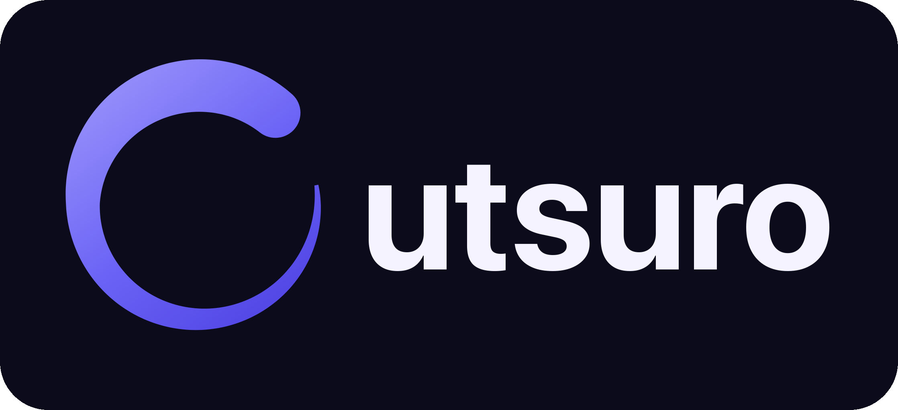
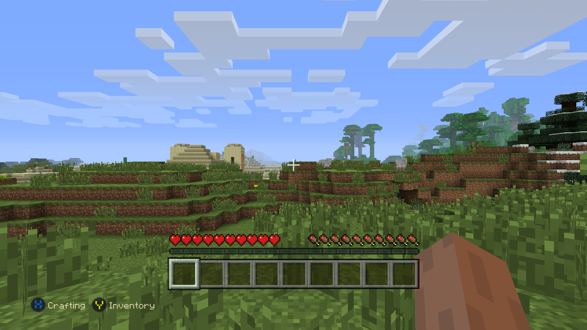
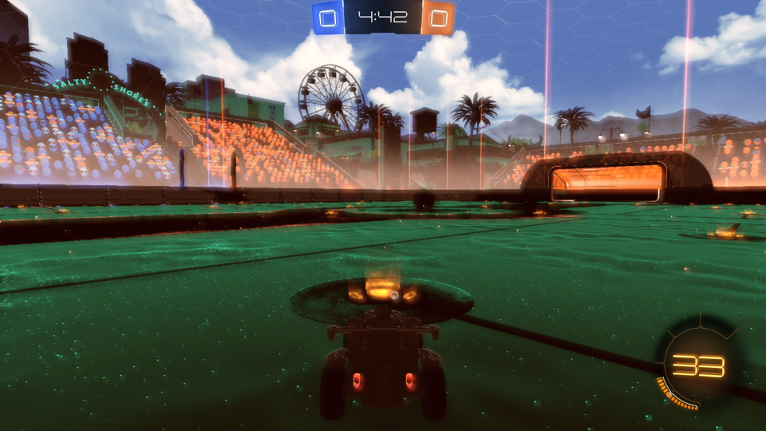
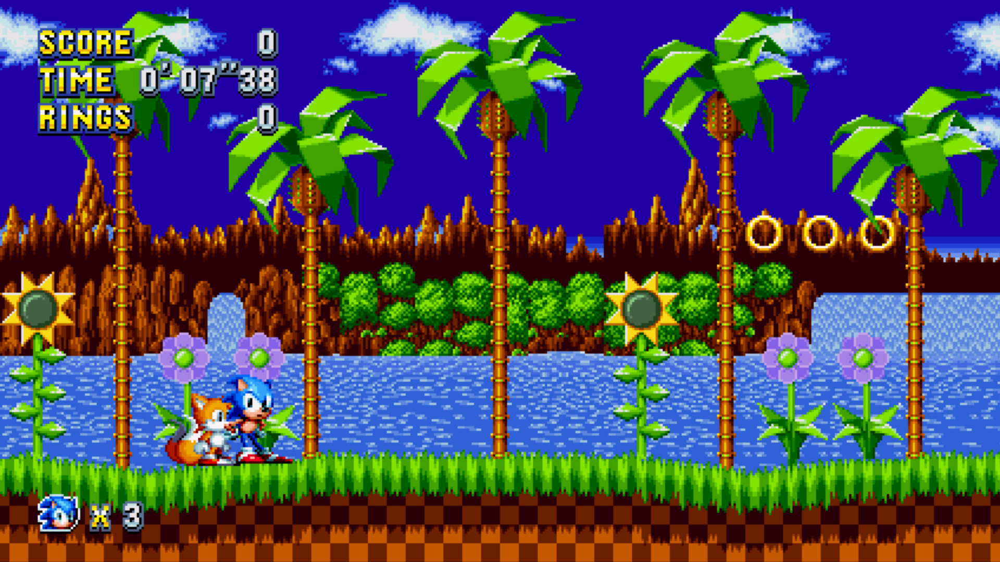

<p align="center"></p>

# Utsuro

An Xbox One (Durango) translation layer for macOS, later iOS. It does not emulate the console's
hardware: it runs the console's own Windows-derived userland (ntdll, kernelx, combase, vccorlib, the CRT)
as x86-64 under FEXCore and supplies what the hardware and the system partitions would have supplied.

**Status:** three Xbox One titles run on the Mac build today: Minecraft: Xbox One Edition (1.2.0.0), Rocket League
(1.0.4.2) and Sonic Mania (1.0.4.2). They boot, render through Metal, take controller / keyboard / mouse input,
play sound (Rocket League has none yet) and can be played. Worlds and options are saved and loaded again (see Saves).
iOS builds exist but have not been tested on a phone yet.

## Showcase

| Minecraft: Xbox One Edition | Rocket League | Sonic Mania |
| --- | --- | --- |
|  |  |  |
| Console OS 6.2 (2014). Menus, worlds, saves, sound, ~36-60 fps. | Console OS 6.2 (2015), Unreal Engine 3. 3D matches render and drive; ~15-20 fps, no audio yet. | Console OS 6.2 (2018). Intro, menus, attract demos and levels; ~57 fps with sound. |

Screenshots are straight from the Mac harness (`UTSURO_DUMPFRAMES`), not mock-ups.

## Games

| Game | State |
| --- | --- |
| Minecraft: Xbox One Edition 1.2.0.0 | playable |
| Sonic Mania 1.0.4.2 | playable |
| Rocket League 1.0.4.2 | matches render and respond to the pad; lighting is dark, slow, silent |

Games need their own decrypted dump (`Mount/` + `EmbeddedXvd/`); none are included. A game built for a console OS
version that has not been seen before needs its `data/kusd/` tables generated first (`tools/kusd_scan.py`).

### Candidates to try next

Roughly easiest first, judged by how much of the console API they are likely to need:

1. **Arcade Classics Anniversary Collection, Dig Dug, Galaga, Pac-Man** - tiny 2D titles, a good check of the new 2018 OS path.
2. **Undertale**, **Peggle 2**, **Lumines Remastered**, **Puyo Puyo Tetris** - 2D, small, simple D3D11 use.
3. **Mega Man 11**, **Overcooked**, **Rayman Legends**, **Terraria**, **Crash Bandicoot N. Sane Trilogy** - bigger, but plain
   forward-rendered 3D or 2D with ordinary shaders; the Rocket League work (texture streaming, post-processing) carries over.
4. **Minecraft Story Mode**, **ABZU**, **Okami HD** - larger engines; expect missing WinRT classes and some compute shaders.
5. **Forza Motorsport 6 / 7, Forza Horizon, Sonic Forces, Titanfall, Wolfenstein II, Ghost Recon Wildlands** - long shots:
   they need compute and geometry shader translation, large streaming and tens of gigabytes of data.

## What is where

| Area | Files |
| --- | --- |
| x86-64 guest on arm64 | `src/engine/` (FEXCore driver, guest memory, crash handler) |
| NT kernel half | `src/nt/` (`sys_*.cpp` syscalls, `process.cpp`, `vm.cpp`, `registry.cpp`, `kusd.cpp`) |
| WinRT objects | `src/nt/winrt*.cpp`, generated from `ref/WinDurango/idl` by `tools/gen_winrt.py` |
| Direct3D 11.X | `src/nt/d3d.cpp`, `d3d_gpu.inc`, interface tables from `tools/gen_d3d.py` |
| Shaders and rendering | `src/gpu/dxbc.cpp` (DXBC → MSL), `src/gpu/renderer.mm` (Metal) |
| Audio | `src/nt/xaudio2.cpp` (XAudio2 host), `src/host/audio.mm` (CoreAudio) |
| Window and input | `src/host/window.mm`, `src/host/input.mm` |

## Building

Needs Xcode (Metal toolchain) and the FEXCore macOS build from the Fathom project
(`~/Documents/Coding/fathom` and `fathom-fexcore`); see `scripts/build.sh`.

```
python3 -m venv tools/venv && tools/venv/bin/pip install pefile capstone   # for the tools
git clone https://github.com/WinDurango/WinDurango ref/WinDurango            # IDL / header reference
scripts/build.sh
```

## Running

The game is a decrypted dump with `Mount/` (the package) and `EmbeddedXvd/` (the console OS image):

```
build/utsuro-run games/mc-1.2.0.0
```

Controls (keyboard): `WASD` left stick, `IJKL` right stick (or the mouse after a click; `Esc` releases it),
arrows D-pad, `Return`/`Space` A, `Backspace`/`Esc` B, `X`, `Y`, `Q`/`E` shoulders, `Z`/`V` triggers, `Tab` View, `P` Menu.
A game controller works too.

## Saves

Connected storage (the console's save data) is kept on disk, one directory per container with one file per
blob, below `~/Library/Application Support/Utsuro/saves` (override with `UTSURO_SAVES=dir`).

## Debugging

`scripts/run.sh [seconds]` runs headless and kills the process afterwards (log in `/tmp/run.log`).
`scripts/session.sh start` + `scripts/ctl.sh press A` / `scripts/ctl.sh snap /tmp/x.png` drive a live
headless run (no window needed); `scripts/playworld.sh` walks the menus into a new world.
Environment: `UTSURO_LOG=debug`, `UTSURO_DUMPFRAMES=dir`, `UTSURO_DUMPSHADERS=dir`, `UTSURO_DUMPMSL=dir`,
`UTSURO_D3DSTATS=1`, `UTSURO_GPUDEBUG=nodepth,nocull,noblend`, `UTSURO_HEADLESS=1`, `--trace`.

## iOS

`scripts/package_ipa.sh` builds `~/Desktop/Utsuro.ipa` (`--tipa` for TrollStore): husk-fex's FEXCore (`scripts/build-fex.sh ios`), the runtime
(`scripts/build-ios-core.sh`), then the app in `ios/` (xcodegen), ad-hoc signed with its entitlements. Put the game folder (the one holding
`Mount/` and `EmbeddedXvd/`) in Files › On My iPhone › Utsuro, or use Import in the app. Executable memory comes from a debugger: StikDebug, the
built-in StikJIT helper (iOS 26+), TrollStore or a jailbreak, via the code in `ios/Utsuro/JIT*.swift` and `src/jit/`. The Mac build runs the same
dual-mapped JIT region (`FEX_MAC_PHONE_PATH`), so `scripts/build.sh` tests what ships. Logs: `Documents/utsuro.log`, `utsuro-prev.log`, `utsuro-crash.log`.
